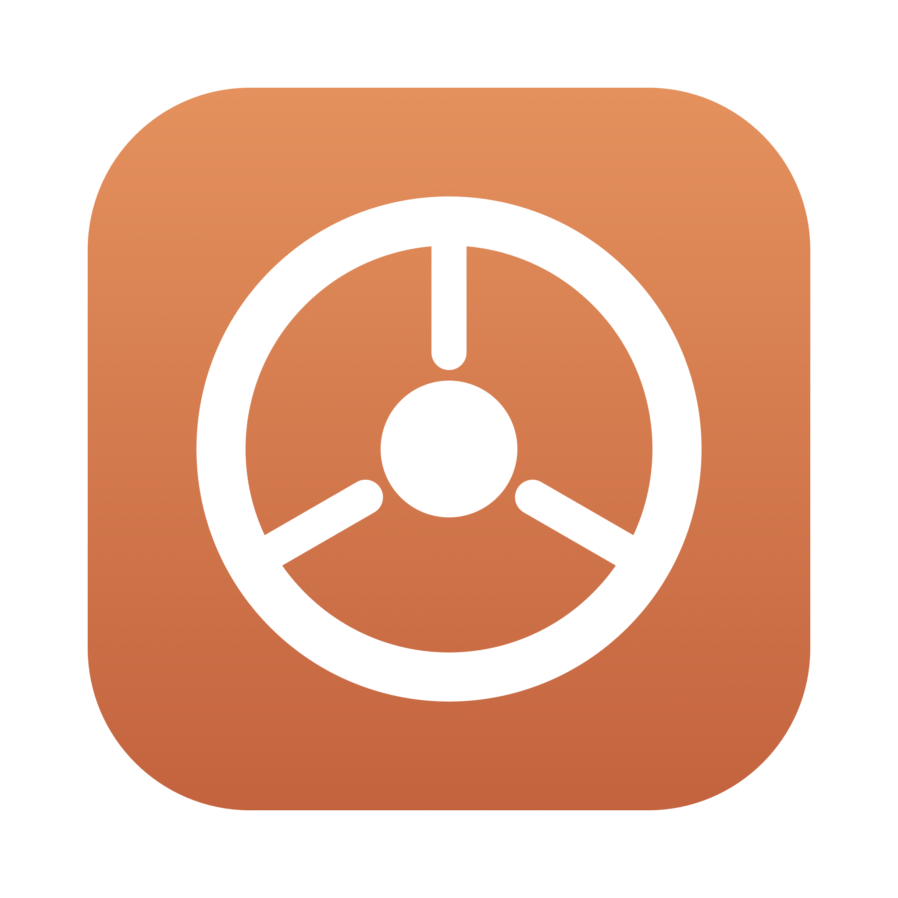

<p align="center"></p>

# FileConvert

macOS menu-bar app to convert, compress and edit files (images, PDFs, documents, audio/video, archives, spreadsheets, markup).

## Download

Get `FileConvert.dmg` from the [latest release](../../releases/latest), open it and drag **FileConvert** to **Applications**.

The app is not notarized. On first launch: right-click the app, choose **Open**, confirm. Or run:

```sh
xattr -dr com.apple.quarantine /Applications/FileConvert.app
```

Requires macOS 14+. Python is bundled, nothing else to install. Some conversions use optional tools (e.g. `ffmpeg`, `pandoc`, `libreoffice`).

## Build from source

```sh
sh build.sh
```

Needs Xcode command line tools (`swiftc`). Output: `build/FileConvert.app`.

## Tests

```sh
python3 -m pytest
```
